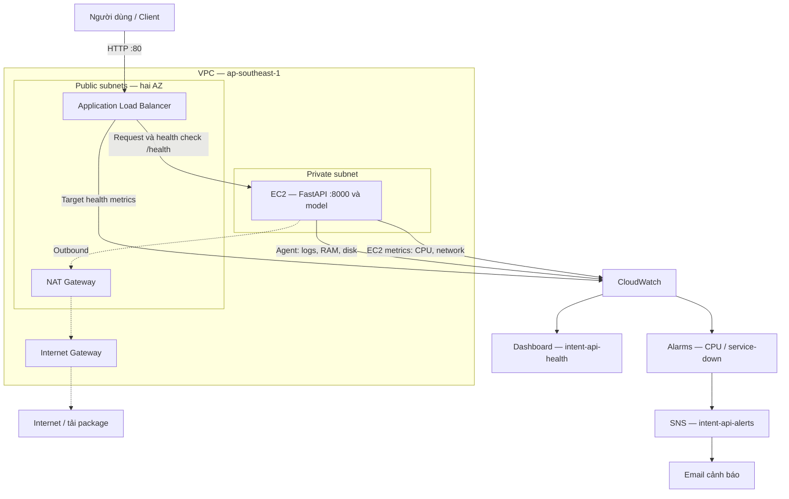
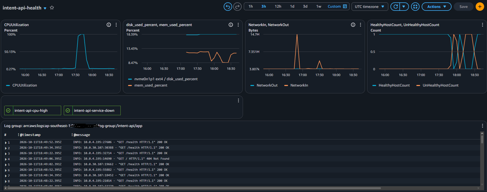
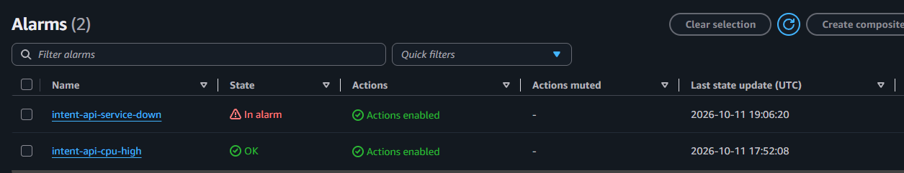
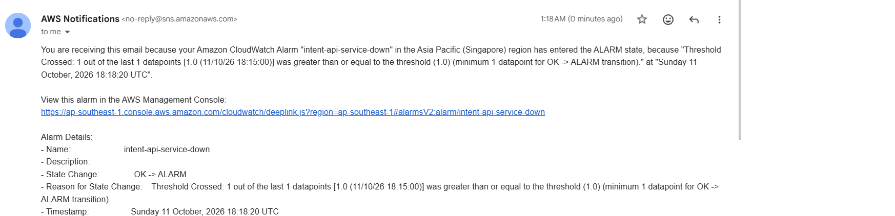

# Intent API — AWS 4-Week Challenge (Capstone)

**Dự án:** AWS 4-Week Challenge · **Region:** Singapore (`ap-southeast-1`).

---

## 1. Giới thiệu dự án

### Tên sản phẩm
**Intent API** — dịch vụ phân loại ý định khách hàng ngân hàng (bank intent classification).

### Bài toán
Các câu hỏi về thẻ, số dư và chuyển khoản có nhiều cách diễn đạt nhưng có thể cùng một nhu cầu hỗ trợ. Dự án xây dựng API nhận diện ý định để hỗ trợ bước định tuyến yêu cầu cho chatbot hoặc hệ thống chăm sóc khách hàng.

### Giải pháp và chức năng

- Nhận câu hỏi qua endpoint `POST /predict`.
- Biểu diễn văn bản bằng TF-IDF và phân loại bằng Logistic Regression.
- Trả về `intent` và `confidence`; model được nạp khi process khởi động và dùng lại trong RAM.
- Kiểm tra độ dài đầu vào từ 1 đến 500 ký tự; dữ liệu không hợp lệ trả HTTP 422.
- Cung cấp `/health` cho health check và `/docs` để thử API.
- Theo dõi tài nguyên, logs và trạng thái target; gửi email khi Alarm kích hoạt.

Ứng dụng chưa sử dụng database và chưa có cơ chế trả nhãn “không xác định” cho câu ngoài phạm vi dữ liệu. `confidence` là xác suất model ước lượng, không bảo đảm dự đoán đúng.

### Công nghệ

| Thành phần | Công nghệ |
|---|---|
| Ngôn ngữ và API | Python, FastAPI, Uvicorn, Pydantic |
| Machine Learning | Scikit-learn, TF-IDF, Logistic Regression |
| Dữ liệu và model | CSV, Pandas, Joblib |
| Hạ tầng | Amazon VPC, EC2, ALB, NAT Gateway, Security Group, IAM |
| Vận hành | systemd, AWS Systems Manager Session Manager |
| Giám sát và cảnh báo | CloudWatch Agent, Logs, Metrics, Alarms, Dashboard, SNS |
| Quản lý source | Git, GitHub |

### Kiến trúc tổng quan



EC2 không có public IPv4. Request từ Internet đi qua ALB; kết nối outbound của EC2 đi qua NAT Gateway. Sơ đồ gom các subnet cùng loại để dễ đọc, không biểu diễn số NAT Gateway thực tế. Một EC2 chạy app chưa cung cấp khả năng chịu lỗi ở tầng ứng dụng.

| Thành phần | Vai trò |
|---|---|
| VPC, public/private subnet | Cô lập mạng; ALB ở public subnet, API ở subnet riêng |
| Application Load Balancer + Target Group | Điểm vào duy nhất từ internet, health check `/health` |
| EC2 (Ubuntu) | Chạy Intent API bằng uvicorn, quản lý bằng systemd |
| IAM Role | Cho EC2 quyền đẩy log/metric lên CloudWatch (`CloudWatchAgentServerPolicy`) và truy cập qua Session Manager |
| CloudWatch Agent | Thu log ứng dụng, metric RAM và disk |
| CloudWatch Logs / Metrics / Alarms / Dashboard | Giám sát và trực quan hóa |
| SNS | Gửi email cảnh báo khi alarm kêu |

---

## 2. Hướng dẫn triển khai (Deployment Guide)

### Yêu cầu chuẩn bị

- Tài khoản AWS có quyền tạo tài nguyên trong region **Asia Pacific (Singapore), `ap-southeast-1`**.
- EC2 Ubuntu `amd64` để dùng gói CloudWatch Agent trong hướng dẫn.
- Python tương thích với `week-04/src/requirements.txt` và model đã lưu.
- Email để xác nhận subscription và nhận cảnh báo SNS.
- Session Manager có instance role và kết nối mạng cần thiết để truy cập private EC2.

Tên Security Group dưới đây là tên minh họa; chọn đúng ID tương ứng khi cấu hình.

### Bước 1: Hạ tầng mạng
1. Tạo VPC `10.0.0.0/16` theo thiết kế tuần 1.
2. Theo thiết kế tuần 1, tạo public subnets `10.0.1.0/24`, `10.0.3.0/24` và private subnets `10.0.2.0/24`, `10.0.4.0/24`, chia trên hai AZ; đặt EC2 trong private subnet.
3. Gắn Internet Gateway vào VPC; route table của public subnet trỏ `0.0.0.0/0` về Internet Gateway.
4. Tạo NAT Gateway ở public subnet để EC2 trong private subnet ra internet (cài gói, đẩy log); route table của private subnet trỏ `0.0.0.0/0` về NAT.

### Bước 2: Security Group
| Security Group | Inbound |
|---|---|
| `alb-sg` | HTTP 80 (và 443 nếu có) từ `0.0.0.0/0` |
| `ec2-sg` | TCP 8000 **chỉ từ `alb-sg`**; không mở SSH ra internet (truy cập bằng Session Manager) |

### Bước 3: IAM Role cho EC2
1. Tạo role cho EC2 với policy `CloudWatchAgentServerPolicy` và `AmazonSSMManagedInstanceCore`.
2. Gắn role vào instance (Actions → Security → Modify IAM role).

### Bước 4: EC2 và ứng dụng
Tạo EC2 Ubuntu trong private subnet, gắn `ec2-sg` và instance role; không gán public IPv4. Với cấu hình hiện tại, tài khoản chạy app là `ssm-user`.

```bash
# Kết nối bằng Session Manager, sau đó:
sudo apt update
sudo apt install -y git python3-venv python3-pip
cd /home/ssm-user
git clone https://github.com/qh120411/aws-4week-challenge.git
cd aws-4week-challenge/week-04/src

python3 -m venv ~/venv
source ~/venv/bin/activate
python -m pip install -r requirements.txt
python -m pip check
```

Chạy API như một dịch vụ systemd:
```bash
sudo mkdir -p /var/log/intent-api && sudo chown ssm-user /var/log/intent-api
sudo nano /etc/systemd/system/intent-api.service
```
Dán cấu hình thực tế sau vào file service, lưu bằng Ctrl+O → Enter → Ctrl+X:

```ini
[Unit]
Description=Intent API
After=network.target

[Service]
User=ssm-user
WorkingDirectory=/home/ssm-user/aws-4week-challenge/week-04/src
ExecStart=/home/ssm-user/venv/bin/uvicorn app.main:app --host 0.0.0.0 --port 8000
Restart=always
StandardOutput=append:/var/log/intent-api/app.log
StandardError=append:/var/log/intent-api/app.log

[Install]
WantedBy=multi-user.target
```

```bash
sudo systemctl daemon-reload
sudo systemctl enable --now intent-api
# Nếu service đã chạy trước đó, restart để dùng cấu hình mới:
sudo systemctl restart intent-api
sudo systemctl status intent-api --no-pager
curl -i http://127.0.0.1:8000/health
```

Model được load từ `model/model.joblib` một lần khi mỗi process app khởi động; request dùng lại model trong RAM, không huấn luyện lại. Nếu cần train lại, chạy `python train.py` từ `week-04/src`; giữ môi trường train và inference tương thích.

Khi cập nhật source, chạy `git pull --ff-only origin main` tại thư mục gốc repo rồi restart service. Push GitHub không tự deploy lên EC2.

### Bước 5: ALB và Target Group
1. Tạo Target Group (HTTP, port 8000), health check path `/health`, đăng ký EC2.
2. Tạo Application Load Balancer (internet-facing) ở các public subnet, gắn `alb-sg`, listener HTTP 80 chuyển tới Target Group.
3. Đợi target ở trạng thái `healthy`.

### Bước 6: Cấu hình CloudWatch

**6.1 CloudWatch Agent**
```bash
wget https://amazoncloudwatch-agent.s3.amazonaws.com/ubuntu/amd64/latest/amazon-cloudwatch-agent.deb
sudo dpkg -i amazon-cloudwatch-agent.deb

sudo cp /home/ssm-user/aws-4week-challenge/week-03/cloudwatch/agent-config.json \
        /opt/aws/amazon-cloudwatch-agent/bin/config.json

sudo /opt/aws/amazon-cloudwatch-agent/bin/amazon-cloudwatch-agent-ctl \
  -a fetch-config -m ec2 -s \
  -c file:/opt/aws/amazon-cloudwatch-agent/bin/config.json
sudo systemctl status amazon-cloudwatch-agent
```
| Dữ liệu | Cấu hình |
|---|---|
| File log ứng dụng | `/var/log/intent-api/app.log` |
| Log Group / Stream | `/intent-api/app` / Instance ID |
| Log retention | 7 ngày |
| Metric RAM | `mem_used_percent` |
| Metric disk | `disk_used_percent` cho filesystem `/` |
| Namespace / chu kỳ agent | `CWAgent` / 60 giây |

Trong JSON, measurement của disk là `used_percent`; tên metric trên CloudWatch là `disk_used_percent`. CPU và network lấy từ metrics EC2. Nếu agent báo lỗi đặt retention, kiểm tra role có quyền `logs:PutRetentionPolicy`.

**6.2 SNS**
1. Tạo topic Standard `intent-api-alerts`.
2. Tạo subscription giao thức Email, **xác nhận trong hộp thư**.

**6.3 Alarms** (cả hai gửi thông báo về `intent-api-alerts`)

Các thông số dưới đây là cấu hình đề xuất trong bản nháp, cần đối chiếu và thay bằng cấu hình thực tế trên Console trước khi nộp. Minh chứng tuần 3 đã cho thấy alarm service-down với ngưỡng `>= 1` và email đã được nhận; chưa đủ thông tin để xác nhận period, statistic, missing data và ngưỡng CPU.

| Alarm | Metric | Điều kiện |
|---|---|---|
| `intent-api-cpu-high` | EC2 `CPUUtilization` | Average > 80, chu kỳ 5 phút |
| `intent-api-service-down` | ApplicationELB `UnHealthyHostCount` (Target Group của API) | Maximum >= 1, chu kỳ 1 phút, missing data = *good* |

**6.4 Dashboard `intent-api-health`**
Gồm 6 widget: CPU, RAM và disk, Network, Healthy/UnHealthy host của ALB, trạng thái 2 alarm, bảng log `/intent-api/app`.

### Bước 7 (khuyến nghị): AWS Budgets
Tạo Monthly cost budget, cảnh báo ở 80% và 100% qua email.

---

## 3. Hướng dẫn kiểm thử (Verification)

### 3.1 Kiểm tra ứng dụng
DNS ALB đã kiểm tra:

```text
ai-api-alb-1828330470.ap-southeast-1.elb.amazonaws.com
```

Swagger: [Mở trang kiểm thử API](http://ai-api-alb-1828330470.ap-southeast-1.elb.amazonaws.com/docs)

Không thêm `:8000` vào URL ALB; listener hiện dùng HTTP 80. Nếu tạo lại ALB, cập nhật DNS tương ứng.

```bash
# Health check
curl http://ai-api-alb-1828330470.ap-southeast-1.elb.amazonaws.com/health

# Tài liệu API tương tác (Swagger)
# Mở trình duyệt: http://ai-api-alb-1828330470.ap-southeast-1.elb.amazonaws.com/docs

# Gọi dự đoán intent
curl -X POST http://ai-api-alb-1828330470.ap-southeast-1.elb.amazonaws.com/predict \
  -H "Content-Type: application/json" \
  -d '{"text": "Tôi muốn khóa thẻ"}'
```
| Chức năng | Cách kiểm tra | Kết quả mong đợi |
|---|---|---|
| Health check | `GET /health` | HTTP 200, `{"status":"ok"}` |
| Swagger UI | Mở `/docs` qua ALB | Hiển thị tài liệu và nút Try it out |
| Dự đoán intent | `POST /predict` với JSON hợp lệ | HTTP 200, có `intent` và `confidence` |
| Target Group | Xem Targets trong EC2 Console | EC2 ở trạng thái Healthy |

Các ca đầu vào đã kiểm thử trên bản tuần 4:

| Dữ liệu | HTTP status | Kết quả |
|---|---:|---|
| `{"text":"Tôi muốn khóa thẻ"}` | 200 | Intent `lockcard`, kèm `confidence` |
| `{"text":""}` | 422 | `string_too_short` |
| `text` dài hơn 500 ký tự | 422 | `string_too_long` |

`confidence` là xác suất ước lượng của model, không bảo đảm dự đoán đúng. Nếu đã bật trim trong schema, cần kiểm tra thêm đầu vào toàn khoảng trắng trả 422. `/health` chỉ phản hồi trạng thái đơn giản; `/` trả 404 vì không khai báo route, không phải bằng chứng app ngừng hoạt động.

### 3.2 Kiểm tra giám sát

| Thành phần | Thao tác kiểm tra | Kết quả mong đợi |
|---|---|---|
| Logs | Gọi API, mở `/intent-api/app` và stream của EC2 | Có request mới với endpoint và HTTP status tương ứng |
| Metrics | Mở namespace `CWAgent`, chọn đúng instance | Có `mem_used_percent`, `disk_used_percent` |
| Dashboard | Mở `intent-api-health`, chọn khoảng thời gian gần nhất | Có dữ liệu CPU, RAM/disk, network, target health và logs |
| SNS | Kiểm tra subscription email | Trạng thái Confirmed |
| Alarm | Mô phỏng sự cố theo hướng dẫn bên dưới | Alarm chuyển ALARM và có email cảnh báo |

**Alarm CPU** (mô phỏng tải)
```bash
sudo apt install -y stress-ng
nohup stress-ng --cpu 0 --timeout 900s > /tmp/stress.log 2>&1 &
```
Theo dõi metric và alarm trong thời gian kiểm thử. Alarm chỉ chuyển ALARM nếu metric vượt ngưỡng đủ số datapoint theo cấu hình; không bảo đảm thời gian cố định. Bài test này dùng CPU trong tối đa 15 phút; chỉ chạy khi cần xác minh alarm trong môi trường demo.

**Alarm service down** (mô phỏng sự cố)
```bash
sudo systemctl stop intent-api
```
Chờ health check đánh dấu target `unhealthy`, metric và alarm cập nhật theo chu kỳ đã cấu hình; xác nhận trạng thái **In alarm** và email SNS. Bật lại dịch vụ:
```bash
sudo systemctl start intent-api
```
Target trở lại `healthy` và alarm về **OK**.

**Dashboard**
Mở CloudWatch → Dashboards → `intent-api-health`: các biểu đồ phản ánh đợt tăng CPU và đợt API ngừng chạy vừa mô phỏng.

Ảnh minh chứng tuần 3 (không thay thế kiểm tra trạng thái hiện tại):







---

## 4. Tổng kết 4 tuần

### Dịch vụ AWS đã sử dụng

| Tuần | Nội dung | Dịch vụ / công nghệ |
|---|---|---|
| 1 | Nền tảng mạng và ý tưởng | Thiết kế VPC, subnet, Internet Gateway, NAT Gateway, route table, Security Group |
| 2 | Triển khai ứng dụng | EC2, IAM Role, Application Load Balancer, Target Group, systemd |
| 3 | Quan sát hệ thống | CloudWatch Agent, Logs, Metrics, Alarms, Dashboard, SNS |
| 4 | Hoàn thiện | Rút gọn requirements, giới hạn đầu vào 1–500 ký tự, kiểm thử 200/422, chuyển systemd sang source tuần 4, kiểm tra log và tổng hợp tài liệu |

### Bài học kinh nghiệm
- **Giám sát phải thử thật**: cần đối chiếu đúng metric, Target Group và điều kiện alarm, rồi mô phỏng sự cố để xác minh cả chuỗi phát hiện lỗi → Alarm → SNS → Email.
- **Metric đến muộn**: metric của ALB và alarm có độ trễ vài phút, cần kiên nhẫn khi kiểm thử.
- **RAM và disk không có mặc định**: phải cài CloudWatch Agent mới thu được.
- **Dịch vụ cần tự phục hồi**: chạy API bằng systemd với `Restart=always` thay vì chạy tay.
- **Bảo mật cơ bản**: Security Group chỉ cho phép ALB gọi vào EC2, không mở SSH, không đưa key hay `.env` lên repo.
- **Quản lý chi phí**: hạ tầng vẫn có thể phát sinh phí khi không gọi API. Stop EC2 không dừng chi phí ALB, NAT Gateway hoặc tài nguyên lưu trữ còn giữ lại.

### Quản lý chi phí và dọn tài nguyên

Hệ thống được duy trì để phục vụ demo và chấm bài. Khi không còn sử dụng:

- Lưu lại source code, cấu hình và minh chứng.
- Xóa ALB, Target Group và EC2 không dùng; kiểm tra EBS và snapshot còn sót.
- Xóa NAT Gateway, giải phóng Elastic IP không còn sử dụng.
- Rà soát CloudWatch, SNS và các tài nguyên mạng còn lại.

Theo dõi chi phí trong Billing và thiết lập AWS Budgets nếu cần. Budget
chỉ hỗ trợ cảnh báo, không tự động dừng tài nguyên hoặc giới hạn chi tiêu.

---

## Cấu trúc repository

```bash
aws-4week-challenge/
├── .gitignore                    
├── README.md
├── week-01/
├── week-02/
├── week-03/
└── week-04/
    ├── src/
    └── demo/                   
```